# MINI-VAULT — Danh mục chi tiết có ảnh

Dùng **mã CT + tên chi tiết** dưới đây khi trao đổi hoặc yêu cầu sửa mô hình. Ví dụ: “Tăng độ dày **CT02 – Cánh cửa**”, “Sửa rãnh của **CT21 – Con trượt khóa**”, “Đổi vị trí chốt trên **CT10 – Đĩa mã 2**”. Tên trong dấu `backtick` là giá trị `part` tương ứng trong [mini-vault.scad](../mini-vault.scad).

Danh mục gồm **22 chi tiết**, mỗi mã ứng với một chi tiết trong mô hình. Những chi tiết cùng hình dạng vẫn có mã riêng để chỉ đúng vị trí. Mã CT chỉ dùng trong tài liệu này, không thay tên selector của source.

Ảnh render trực tiếp từ source ngày **16/10/2026**, với tham số **Default** (`size_scale=1`, vỏ 142 × 100 × 84 mm). Mỗi ảnh được phóng vừa khung riêng nên **không dùng kích thước trên ảnh để so tỷ lệ giữa các chi tiết**. Màu chỉ giúp nhìn hình. Hướng ảnh riêng không phải hướng đặt lên bàn in.

Ảnh thu nhỏ **150 px**; bấm vào ảnh để mở bản lớn.

| Mã | Ảnh | Tên chi tiết / selector | Nhận dạng |
| :--- | :---: | :--- | :--- |
| **CT01** | <a href="parts/housing.png">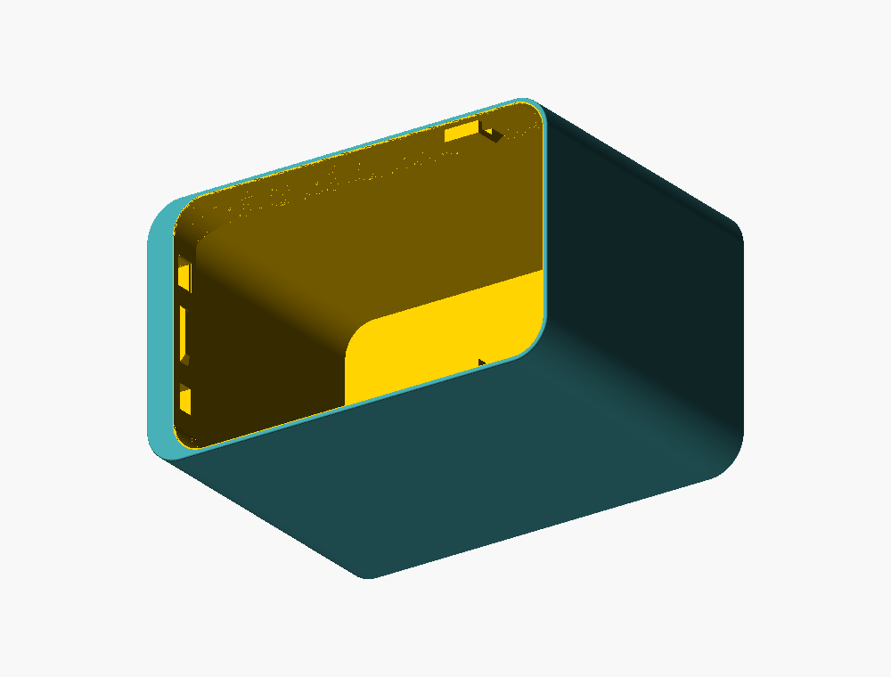</a> | **Vỏ hộp** `housing` | chi tiết lớn dạng hộp rỗng, bốn góc bo tròn; mặt trước mở để lắp cửa. |
| **CT02** | <a href="parts/door.png">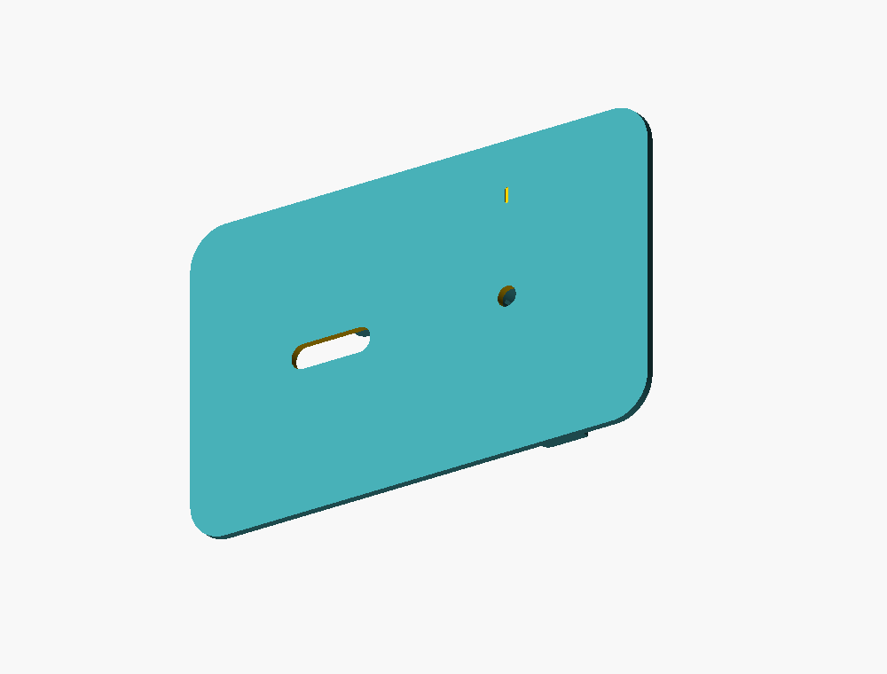</a> <a href="parts/door-inside.png">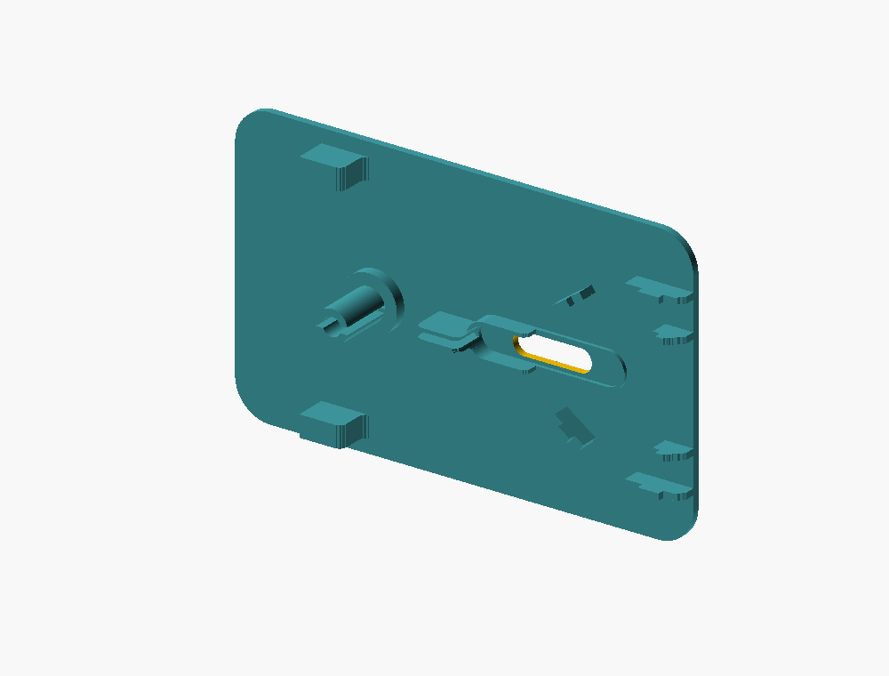</a> | **Cánh cửa** `door` | tấm chữ nhật bo góc, có lỗ tròn cho trục mặt số, lỗ dài cho phần tay kéo của con trượt và vạch chỉ số ở mặt ngoài. |
| **CT03** | <a href="parts/hinge_socket_top.png">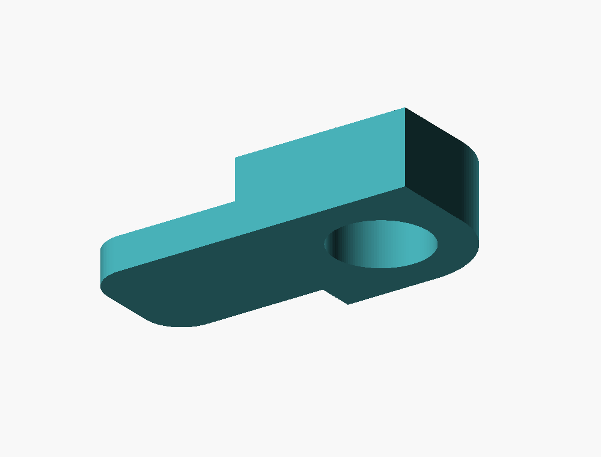</a> | **Gối bản lề trên** `hinge_socket_top` | khối gối nhỏ có vùng nhận trục/chốt bản lề và phần chân/ngàm định vị.. |
| **CT04** | <a href="parts/hinge_socket_bottom.png">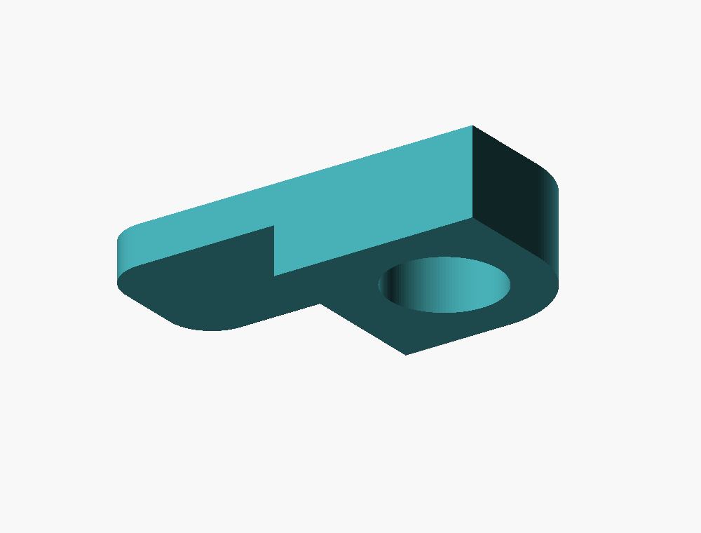</a> | **Gối bản lề dưới** `hinge_socket_bottom` | cùng họ hình học với CT03, được lật đối xứng theo chiều trên/dưới trong source.. |
| **CT05** | <a href="parts/hinge_leaf_top.png">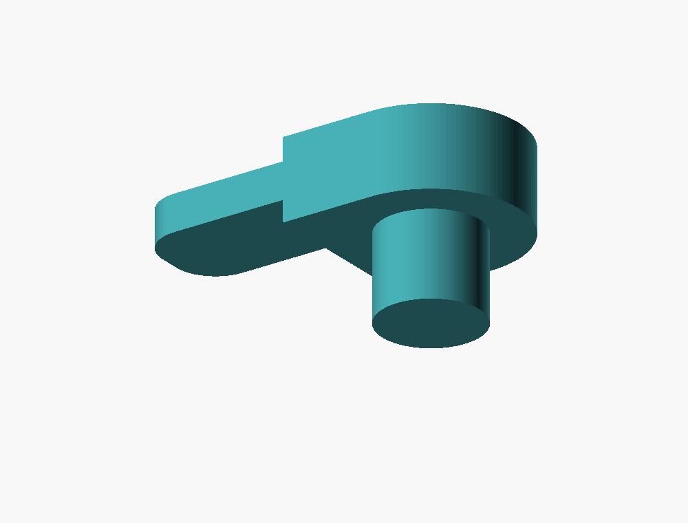</a> | **Lá bản lề trên** `hinge_leaf_top` | chi tiết nhỏ có phần thân/ngàm và phần trục nhô để ghép vào gối bản lề.. |
| **CT06** | <a href="parts/hinge_leaf_bottom.png">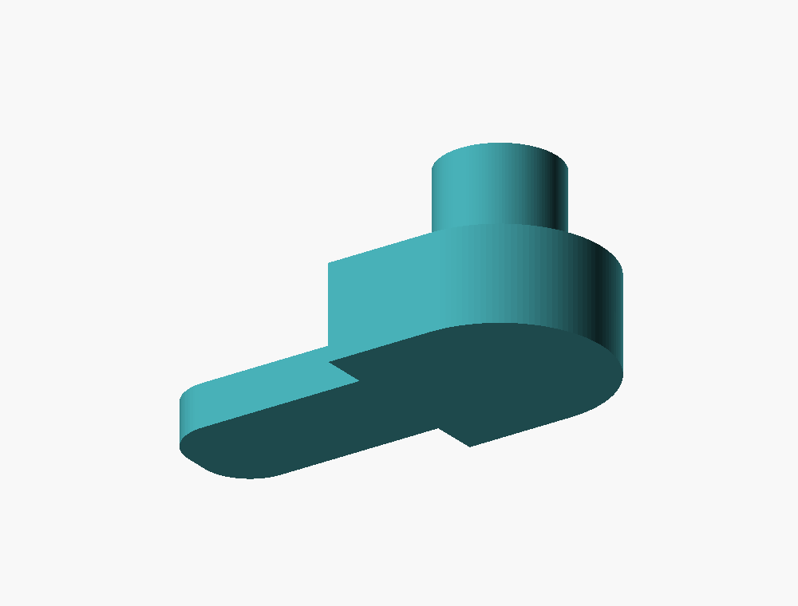</a> | **Lá bản lề dưới** `hinge_leaf_bottom` | bản đối xứng trên/dưới của CT05 trong mô hình.. |
| **CT07** | <a href="parts/dial.png">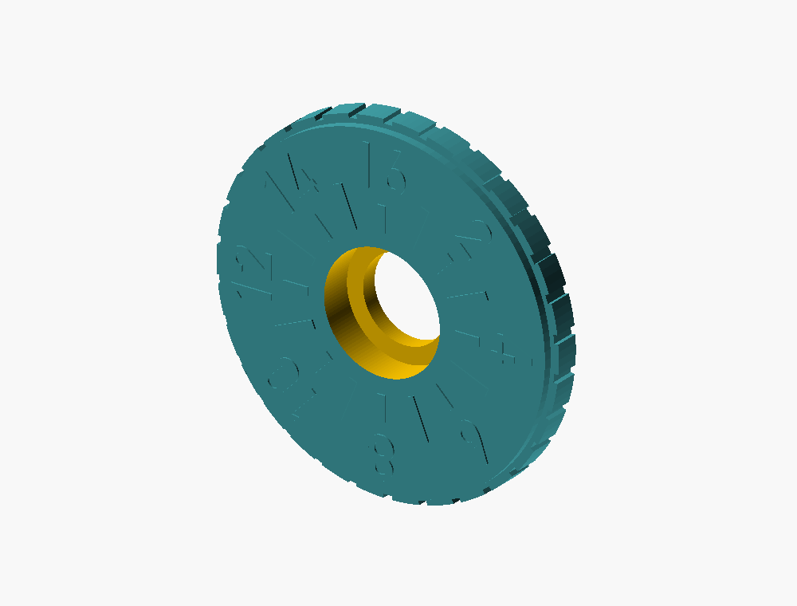</a> | **Núm xoay mặt số** `dial` | đĩa tròn lớn có số/vạch quanh mặt trước, vành cầm quanh chu vi và lỗ ghép trục ở giữa.. |
| **CT08** |  | **Trục mặt số** `shaft` | trục dài có đầu tròn dạng bích, đoạn ghép định hình dưới đầu và các đoạn/rãnh giữ ở cuối trục.. |
| **CT09** |  | **Đĩa mã 1** `disk_1` | đĩa tròn mỏng có lỗ tâm lớn, vòng lỗ nhỏ để đặt chốt và một rãnh khuyết ở mép ngoài.. |
| **CT10** |  | **Đĩa mã 2** `disk_2` | cùng hình học cơ bản với CT09, nằm giữa đĩa 1 và đĩa 3 khi lắp.. |
| **CT11** | <a href="parts/disk_3.png">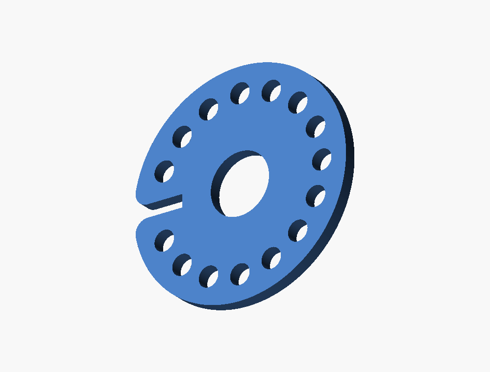</a> | **Đĩa mã 3** `disk_3` | cùng họ đĩa tròn có lỗ và rãnh mép, ở vị trí xa cửa nhất trong cụm ba đĩa.. |
| **CT12** |  | **Vòng cổ 1** `collar_1` | chi tiết vòng có lỗ xuyên tâm, vai tựa và các tai/gờ trên thân; khác đĩa mã ở chỗ không có cả vòng lỗ đặt chốt.. |
| **CT13** |  | **Vòng cổ 2** `collar_2` | cùng hình học cơ bản với CT12, ở tầng giữa của cụm đĩa.. |
| **CT14** | <a href="parts/collar_3.png">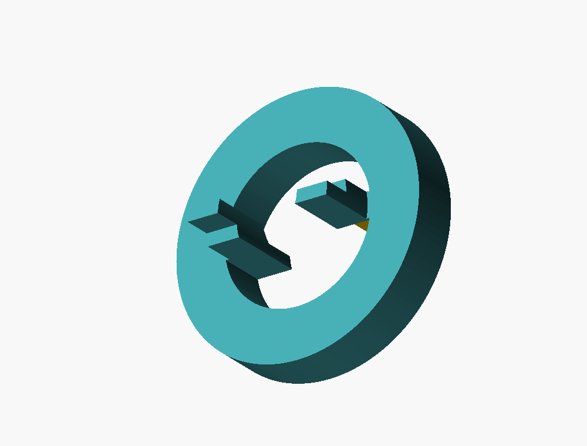</a> | **Vòng cổ 3** `collar_3` | cùng họ vòng có vai tựa và tai/gờ, ở tầng xa cửa nhất của ba vòng cổ.. |
| **CT15** |  | **Chốt đĩa 1** `fastener_1` | chốt nhỏ có thân tròn và đầu lớn bo tròn; không có ren vít trong mô hình.. |
| **CT16** |  | **Chốt đĩa 2** `fastener_2` | cùng hình học chốt đầu tròn với CT15.. |
| **CT17** | <a href="parts/fastener_3.png">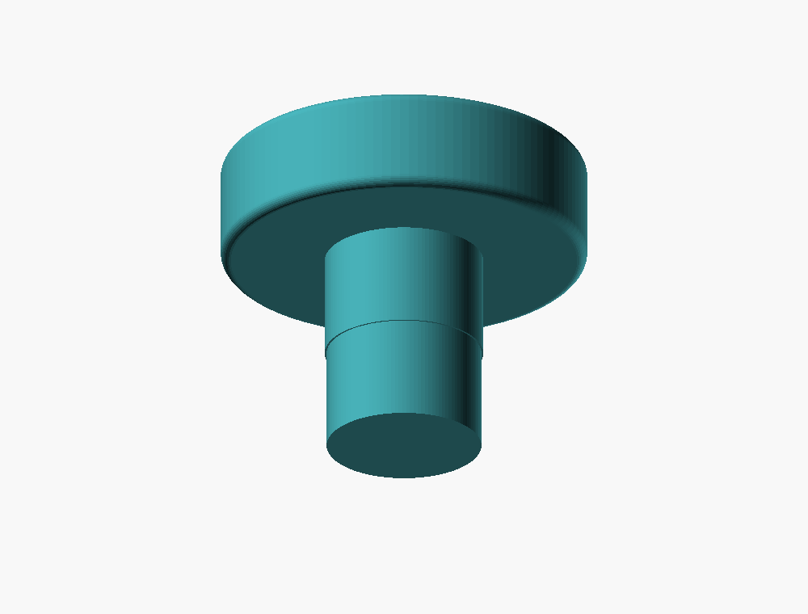</a> | **Chốt đĩa 3** `fastener_3` | cùng họ chốt nhỏ đầu tròn, dành cho đĩa xa cửa.. |
| **CT18** |  | **Vòng chặn trục** `retaining_ring` | vòng nhỏ có khe hở, khác các vòng cổ có vai/tai đỡ đĩa.. |
| **CT19** | <a href="parts/knob.png">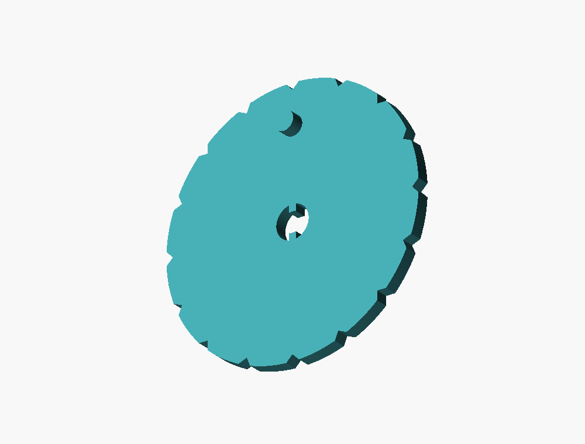</a> | **Núm trong** `knob` | đĩa tròn nhỏ có vành khía để cầm, lỗ tâm định hình và một chốt nhô lệch tâm trên mặt đĩa; không có dãy số như CT07.. |
| **CT20** | <a href="parts/link.png">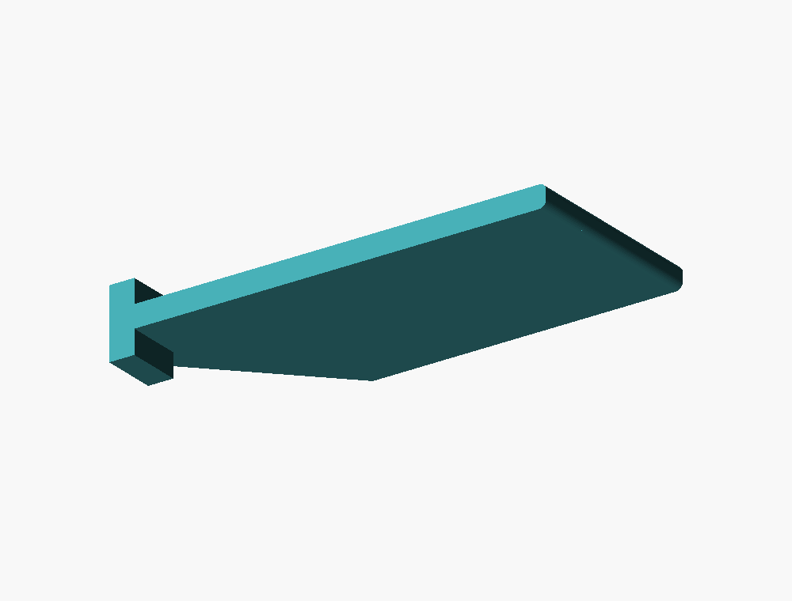</a> | **Thanh liên kết** `link` | thanh dài hẹp, một đầu có phần nhô dạng chữ T, thân có vùng tăng chiều sâu và mặt vát.. |
| **CT21** | <a href="parts/latch.png">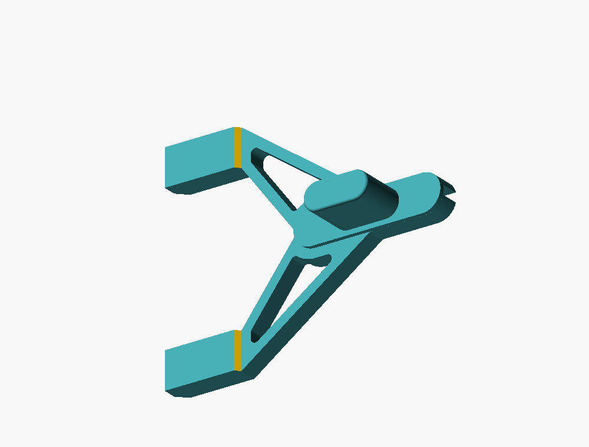</a> | **Con trượt khóa** `latch` | chi tiết trượt lớn có thân then, khoang/rãnh dẫn, cổ nối và núm cầm bo tròn liền khối. |
| **CT22** | <a href="parts/latch_cover.png">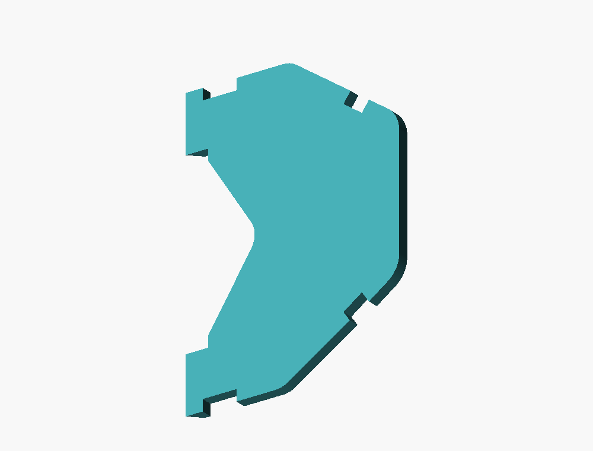</a> | **Nắp che con trượt** `latch_cover` | tấm mỏng biên dạng không đều, có ngàm/tai ở mép và cạnh vát; khác cánh cửa lớn CT02.. |

## Quy ước vị trí

- **Mặt ngoài cửa**: phía người sử dụng nhìn thấy núm mặt số và tay kéo khóa.
- **Mặt trong cửa**: phía có cụm ba đĩa mã và cơ cấu gài khóa, hướng vào lòng hộp.
- **Trên/dưới**: theo chiều đứng của hộp trong mô hình lắp, không theo chiều ảnh riêng.
- **Đĩa 1 → 2 → 3**: theo thứ tự trong source, từ gần cánh cửa ra phía trong hộp. Vòng cổ và chốt mang cùng số thuộc vị trí đĩa tương ứng.

Mô tả nhận dạng dựa trên hình học và cách bố trí trong source hiện tại. Mô tả chức năng cơ khí là cách hiểu của mô hình tái dựng, chưa thay cho hướng dẫn lắp đã thử thực tế.

## Cách đề cập khi yêu cầu sửa

- “Cho **núm cầm CT21** to hơn, giữ nguyên rãnh T.”
- “Tăng **độ dày cánh cửa CT02**, giữ vị trí lỗ trục CT08.”
- “Nới khe giữa **CT05 và CT03** ở bản lề trên.”
- “Đổi vị trí **chốt CT16 trên đĩa CT10**.”
- “Làm chữ/số trên **CT07** rõ hơn.”

Muốn mở riêng một chi tiết: mở `mini-vault.scad`, chọn **Display → part** bằng tên source nêu ở mục tương ứng. Muốn xem tương quan vị trí: chọn `assembly`; muốn bung cụm: chọn `exploded`. STL theo hướng in nằm trong [bộ 200](https://github.com/TimTini/mini-vault/releases/latest) và [bộ 220](https://github.com/TimTini/mini-vault/releases/latest); chúng dùng cùng tên selector nhưng khác preset/kích thước so với ảnh Default trong danh mục này.
